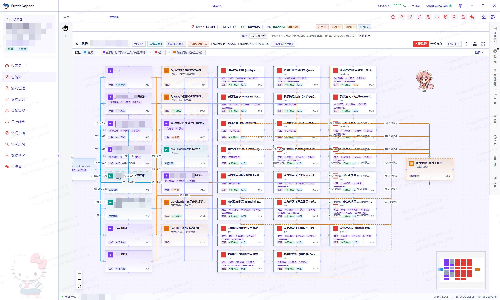
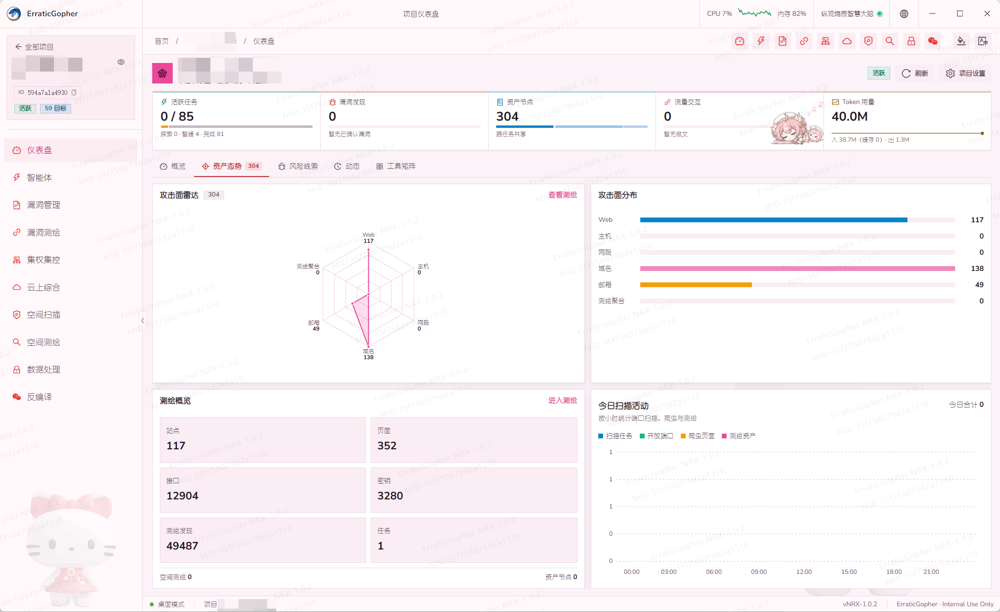
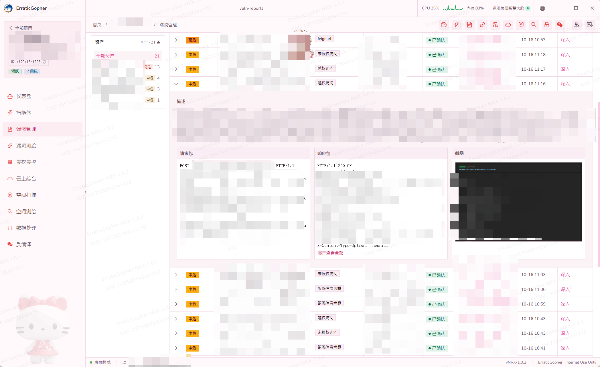
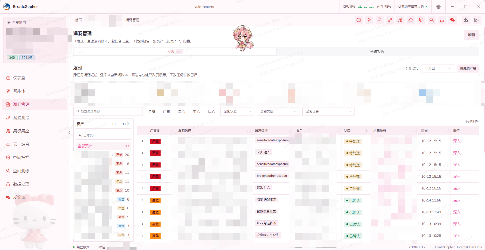

# ErraticGopher

**全鏈路自動化攻擊平台** — 專為授權滲透測試與攻防演練打造之整合型桌面工具。

> **僅限於已取得書面授權之目標使用。** 未經授權之探測、利用或破壞行為可能觸法，相關責任由使用者自行承擔。

## 簡介

ErraticGopher 將**資產發現**、**站點分析**、**自動化滲透**、**漏洞管理**等環節整合於同一桌面應用程式中。資料以**專案**為單位進行隔離管理，各模組之結果可相互連動，並支援由 LLM 驅動之 **ReACT 智慧代理**對目標執行多輪工具調用與瀏覽器實測，最終產出結構化之滲透分析報告。

核心特性：

- **LLM 智慧代理引擎**：對接多種大型語言模型，進行多步推理，自動調用掃描器、瀏覽器、測繪平台等工具鏈
- **內網 Docker 攻擊能力**：智慧代理可調用 Kali 容器執行內網滲透指令
- **Headless 瀏覽器自動化**：SPA 渲染、表單填充、截圖取證、敏感資訊提取
- **多源資產融合**：端口掃描 + 空間測繪 + Web 爬蟲結果統一入库，生成資產全景圖
- **雙通訊模式**：桌面端（Wails WebView）+ Web 端（HTTP/WebSocket）均可運行

---

綜合大屏

專案管理介面一欄

智慧代理攻擊一覽

漏洞匯報一覽

目前已在多場紅隊演練、滲透測試及 SRC 場景中進行驗證，均能產出一定成效。